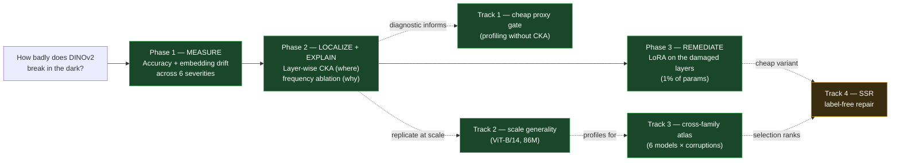
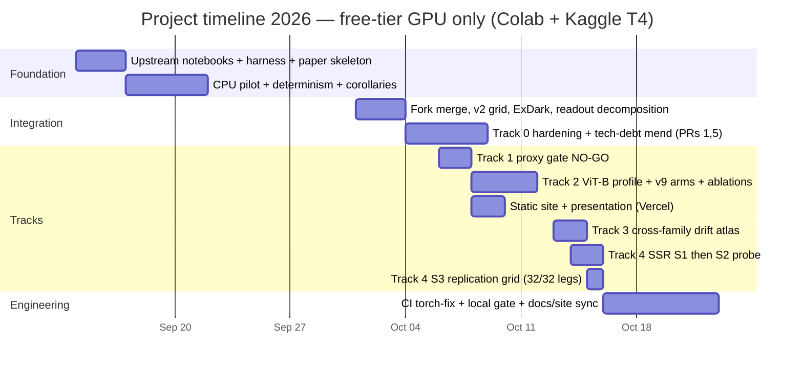
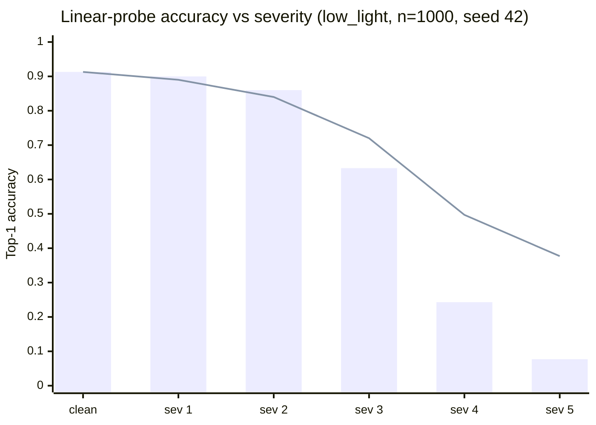
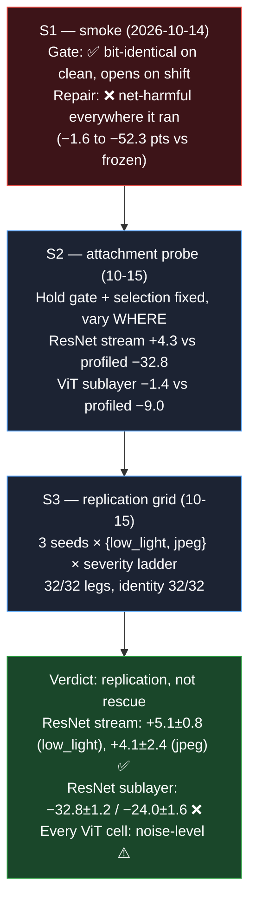
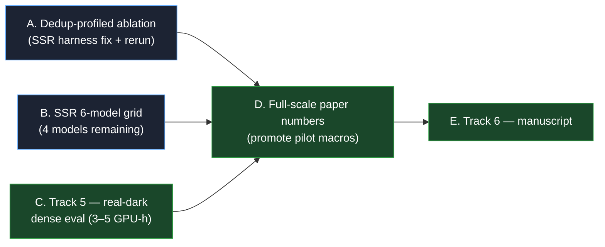

# Project Assessment — DINOv2 Low-Light Robustness Study

*Written 2026-10-22 at repo state `d48f30f` (80 commits, fork `main`). Everything below is
read from committed artifacts — nothing here is aspirational unless it is explicitly in
"What is left". Deep dives: `docs/RESEARCH.md` (findings), `docs/METHODS.md` (protocol),
`docs/ROADMAP.md` (plan), `docs/SSR_PLAN.md` + `docs/DPA_DESIGN.md` (Track 4 pre-registration).*

---

## 1. What we are trying to do

One question, asked causally:

> **When images get dark and noisy, how badly does DINOv2's understanding break — *where*
> in the network, *why*, and can we fix it cheaply?**

DINOv2 (a self-supervised ViT) has a great reputation — but that reputation is measured on
clean, well-lit images. We test it on **CIFAR-10 pushed through a parametric low-light
corruption** (brightness × factor + shot noise; severity 0 = clean → 5 = extreme), with the
backbone **frozen** and a **linear probe trained only on clean images**. That protocol is the
crux: if accuracy drops, the *representation itself* moved — not the classifier.

The study then fans out into generalization questions: does it hold at scale (ViT-B, 86M)?
Across corruptions (blur, JPEG, contrast)? On **real** dark photos (ExDark)? And can the
diagnosis drive a **label-free** repair (SSR), not just a supervised LoRA fix?

## 2. The shape of the answer (design)

Three phases in logical order — each phase's result *predicts* the next phase's design —
plus four follow-on tracks that stress-test generality:

Green = closed with evidence; amber = open in at least one part (§8).

**Hypotheses** (pre-registered in `RESEARCH.md` §3): H1 accuracy degrades severely and
non-linearly · H2 degradation concentrates in late attention layers · H3 it is driven by loss
of **low-frequency luminance structure** · H4 because it is localized, a targeted
parameter-efficient fix recovers most of it.

## 3. What we did, in order

**How** it was done — the working method that produced every number:

| Ingredient | What it means here |
|---|---|
| Frozen backbone + clean-trained linear probe | Isolates *representation damage* from train/test mismatch |
| CKA between clean vs degraded activations at every block | Cheap, layer-resolved "how far did the features move" ruler |
| Free-tier GPU only (Colab/Kaggle T4) | Every experiment fits ~10 min – 1 h; 9 self-contained Kaggle kernels |
| Pre-registered claims + identity gates | Before running, we write what must hold; SSR's gate must be *bit-identical on clean* or the run is void |
| Seeds, CIs, permutation tests everywhere | 3 seeds on every headline arm; paired permutation tests; Wilson/bootstrap CIs |
| Results of record committed in-repo | `output/`, `colab_results/` CSVs/JSON/logs — the presentation and paper read only from these |
| 48-test suite + 15-section presentation site | Torch-free analysis stack tested in CI-recipe environments; site auto-generated from the same code that reads the artifacts |

**Repo/engineering history (80 commits):** forked from `officialarghya29`'s base (upstream
contributed `src/`, `tests/`, `paper/`; the fork contributed runners/`docs/`), 6 PRs merged
upstream, fork PR #2 merged locally, **upstream PR #7 open with green CI** — the fork's own
GitHub Actions are billing-locked (an account issue, not a code issue), so
`scripts/ci_local.sh` reproduces the exact CI matrix locally and is the gate of record.

## 4. What we found

### 4.1 Phase 1 — the failure is real, big, and non-linear (H1 ✅)

- **Bar** = the protocol of record (probe fixed, trained on clean). **Line** = a probe
  retrained per severity (§4.7) — even a *perfect* readout only reaches 0.377.
- 0.91 → ~0.08 is a cliff, not a slope: half the damage happens between sev 3 and 4.
- Embedding drift (cosine to clean) tracks accuracy almost 1:1 — the two are one phenomenon.

### 4.2 Phase 2 — the failure has an address and a mechanism (H2 ✅, H3 ✅)

- **Address:** late attention blocks drift most — CKA drop **0.81 at block 10** vs 0.58 at
  block 0. The damage is *localized*, which is what makes a cheap fix possible at all.
- **Mechanism:** accuracy survives low-pass filtering nearly intact but collapses under
  high-pass — DINOv2 reads **low-frequency luminance structure**, and darkness erases exactly
  that. Frequency ablation and CKA tell the same story from two directions.

### 4.3 Phase 3 — the fix is cheap, and the allocation story is subtle (H4 ✅ with a twist)

- LoRA on QKV/output projections: **221K params = 0.99%** of the network, ~10 GPU-minutes:
  mean 0.59 → 0.82 (+22.4), worst-case 5.1× better, clean accuracy *rises*.
- CKA-guided rank allocation matches uniform LoRA **and** full fine-tuning at 0.78% of the
  params (3 seeds each, error bars fully overlapping). Full FT = same result at 100× the cost.
- **The twist (v9-abl, n=3):** sharpening the profile, hard top-k, or even *inverting* it all
  tie uniform at budget-matching — **the allocation *shape* is inert; coverage is what
  discriminates**. The drift rule earns its keep as a *parameter saving at parity*, not as a
  privileged shape. (This honestly deflates the naive "smart allocation wins" story and is
  exactly the kind of falsification the ablation was pre-registered for.)

### 4.4 Generality: scale, corruptions, real darkness

| Axis | Result |
|---|---|
| **Scale (ViT-B/14, 86M)** | Late-heavy drift replicates; new sublayer finding: **MLP drifts more than attention in all 12 blocks**. LoRA arms: drift-weighted = uniform at **24% fewer params** (n=3). |
| **Corruption families** | Frequency-*destroying* (blur, JPEG) reproduce the late-drift signature and the cliff; frequency-*preserving* (contrast) does not (max drop 0.30, flat profile). Gains track fragility: low_light +22.4 > JPEG +19.3 > blur +17.7 > contrast +7. |
| **Real darkness (ExDark, 7,363 photos)** | Frozen accuracy is **flat** across the luminance axis (0.713 darkest vs 0.704 brightest) and CLAHE buys +0.001 — real darkness is *not* the synthetic cliff. Synthetic-trained adapters still transfer **+1.9 pts**. The sim-to-real gap is quantified, not assumed away. |
| **6-model atlas (Track 3)** | Late-heavy drift is the **cross-family default** across ResNet-50, ViT-S, DeiT-S, Swin-T, ConvNeXt-T, ViT-B; DINOv2 is the *early-heavy outlier* — so the popular "CNNs drift early, ViTs drift late" cut is **wrong**. Mean CKA drop is severity-monotone on all 6 models × 2 corruptions. |

### 4.5 Track 1 — a negative result that shaped everything after

The dream was to replace CKA with cheap amplitude statistics. Pre-registered gate says NO:
best low_light rank correlation with true drift is ρ ≤ 0.69, and it **replicates on all 6
models** (jpeg gets up to ρ≈0.9, low_light never does). "Amplitude statistics cannot rank
structural drift" is now a six-model finding — full CKA stays the profiler, and it costs only
two forward passes per condition (no labels, no backprop), so the "single cheap profiling
pass" claim survives anyway.

### 4.6 Track 4 (SSR) — the label-free repair: gate holds, attachment decides

SSR = match per-channel (μ, σ) of module outputs to clean-run statistics at test time, no
labels. It has a **shift gate** (repair only when drift is detected) and **drift-ranked
top-k selection** (from the Track 3 profiles). The story across three sessions:

**The scientific payload:** the *same* moment-matching math is +5.1 where it attaches to the
final stage boundary (ResNet `stream`) and −32.8 where it attaches mid-network (`sublayer`).
**Where representation damage lives determines where adaptation pays** — that sentence is
the paper's thesis, and SSR is the instrument that demonstrated it both directions.

Two caveats keep this honest (documented in `RESEARCH.md` §6.8/§6.9):
1. The `profiled` arm's selections contain container/child duplicates (the affine composes
   twice), so some profiled harm may be **harness-amplified** — a deduplicated rerun is owed.
2. Two models, two corruptions so far — 4 of the 6 atlas models are untested under SSR.

### 4.7 One more decomposition: how much is the head vs the features?

A severity-adapted probe (retrained per severity) recovers **+30 pts at sev 5** but plateaus
at 0.377 vs 0.913 clean, and its predictions collapse onto a single class (top-1 share
0.14 → 0.73, dominant class *frog*). **Readout staleness is real but half the story; the
binding constraint is the features** — which is precisely why LoRA (features) works and why
the fixed-readout LoRA result already sits at the adapted-readout ceiling.

## 5. Scorecard — how much have we succeeded?

| Question we set out to answer | Status | One-line evidence |
|---|---|---|
| H1 — does it break badly? | ✅ Closed | 0.91 → ~0.08, cliff at sev 3–4 |
| H2 — where? | ✅ Closed (+generalized) | Late blocks, CKA 0.81 @ block 10; late-heavy default on 6 models |
| H3 — why? | ✅ Closed | Low-frequency luminance ablation; blur/JPEG yes, contrast no |
| H4 — cheap fix? | ✅ Closed (+twist) | 0.99% params, +22.4 mean; coverage discriminates, shape inert |
| Does it hold at scale? | ✅ Closed | ViT-B/14 replicates; MLP > attention sublayer drift |
| Does it transfer to real darkness? | ✅ Quantified | ExDark flat curve; adapters +1.9 (real but ~9% of synthetic gains) |
| Can a *label-free* repair work? | ⚠️ Partially | Gate ✅ everywhere; positive regime scope-qualified (1 model × 1 scope × 2 corruptions, replicated over 3 seeds); dedup ablation + 4 models owed |
| Is the story paper-ready? | ❌ Open | Track 6 not started; full-scale numbers pending |

**In one sentence: ~80% of the science is done and defensible; what remains is credibility
hardening (SSR dedup + 6-model grid + real-dark dense eval) and packaging (manuscript).**

## 6. How the findings affect the research

**Strengthened claims** (each replicated beyond its first session):
- "Late-heavy drift is the default under frequency-destroying corruption" — 6 models.
- "1%-parameter LoRA recovers the collapse" — 3 seeds, 2 backbones, 4 corruption families.
- "The drift profile is informative but not privileged" — the inverted-β falsification
  *failed to falsify* (shape-inert), which is a stronger, more honest claim than the original.
- "The identity gate + drift-ranked selection are robust to attachment" — held unchanged in
  every scope of S1–S3.

**Claims that were cut or scoped down (equally important):**
- ~~"Cheap proxies can replace CKA"~~ → NO-GO on 6 models (Track 1).
- ~~"Moment matching repairs the damage"~~ → "…*where it attaches at the final stage
  boundary of a CNN*"; harm elsewhere.
- ~~"Synthetic darkness stands in for real darkness"~~ → real darkness is flat; synthetic is
  the harsher regime; the gap is measured (+1.9 of +22).
- ~~"Drift-weighted allocation beats uniform"~~ → parity at lower cost, shape-inert.

**Direction changes the results caused:** Track 4 exists *because* Track 3's profiles feed
its selection; the S2 attachment probe exists because S1's negative demanded a mechanism
check; the S3 grid exists because a single-seed positive is not a finding. The negative
results each bought the next experiment.

## 7. Engineering & reproducibility state

| Item | State |
|---|---|
| Tests | **48/48** (custom runner; torch-optional tests active locally, skipped in torch-free envs) |
| CI | Fork's GitHub Actions **billing-locked since 10-14** (external); `scripts/ci_local.sh` reproduces the exact 3.10/3.11 matrix + native torch tests + 9 kernel builds + presentation smoke — ALL GREEN. Upstream CI (not billing-locked) ran the same recipe green on PR #7. |
| Kernels | 9 self-contained variants (grid, vitb_profile, v9, v9-abl, atlas, atlas_v4, ssr_s1/s2/s3); manifests verified by tests |
| Site | 15-section static presentation, auto-generated from `apps/presentation.py`, deployed on Vercel; re-exported 2026-10-22 (was stale — `07 §A7`) |
| PRs | Upstream #1–#6 merged; fork #2 merged; **upstream #7 open, checks green**, awaiting upstream review |
| Docs | RESEARCH/METHODS/ROADMAP/SSR_PLAN/DPA_DESIGN + `docs/project-context/` (00–10) current as of 2026-10-22 |

**Bugs as assets:** six bugs were caught by sanity checks *before* any conclusion trusted the
numbers (CKA formula, bootstrap seeds, port-time ordering, worker RNG, kernel exit-verifier
naming, hardcoded report label). All six are published in the presentation's bugs section —
they are part of the methodology contribution.

## 8. What is left to do — and how

### A. Deduplicated-profiled ablation *(owed to §6.8 — do first, it's cheap)*
**Why:** the `profiled` selection double-applies the affine on duplicated container/child
tensors, so the −32.8 profiled harm may be partly harness artifact. Until this reruns, the
"attachment flips the repair" headline leans on a buggy control.
**How:** in `run_ssr.py`/`src/ssr.py`, dedup selections by tensor identity (exclude containers
whose children are already selected — `stream` already does this by construction); add a
regression test; extend the `ssr_s3` kernel; run on Kaggle T4: 2 models × {profiled-dedup,
stream} × low_light × sev 5 × 3 seeds ≈ 12 legs ≈ **~15–20 min**; aggregate with
`scripts/analyze_ssr_s3.py`.

### B. SSR 6-model grid *(the "is the positive regime general?" question)*
**Why:** every SSR positive/negative is currently ResNet-50 + ViT-S only. The atlas already
profiles 6 models, so the selection signal exists for the other 4.
**How:** models `convnext_tiny`, `deit_small_patch16_224`, `swin_tiny_patch4_window7_224`,
`dinov2_vitb14`; scopes {profiled-dedup, stream, sublayer, norm-where-applicable}; corruptions
{low_light, jpeg}; seeds 42/43/44; k=25% + k-matched control at all 3 seeds. Reuse the S3
kernel with a model-list flag — ≈ 70 legs ≈ **~1.5–2 h T4** (S3's 32 legs took 35 min, so
budget is known-good). Outcome either promotes the scope-qualified positive to a general
claim or falsifies it on non-ResNet CNNs/ViTs — both are publishable.

### C. Track 5 — real-darkness dense eval *(the credibility arm)*
**Why:** "your problem is synthetic" is the advisor's #1 acceptance risk; §4.4 shows synthetic
cliff ≠ real darkness on classification, so a dense-task check is the honest next question.
**How:** ACDC night + Dark Zurich (segmentation) with a **frozen** SegFormer/DeepLab head +
SSR recalibration, eval-only; optional DarkFace/ExDark detection arm (norm-layers only).
Datasets hosted on Kaggle (avoid download-quota pain; verify licenses). ~**3–5 GPU-hours**;
this reuses the SSR gate/selection unchanged — it is the framework's first true out-of-
distribution test.

### D. Full-scale paper numbers
Promote the pilot-scale bars/macros (`results_pilot/`) to full-scale runs (n=1000 protocol
already used for the headline curves; the paper's tables currently carry `[pending]`
placeholders). Depends on A+B+C closing so the numbers quoted are final.

### E. Track 6 — manuscript
Framing already chosen: **"Drift-Profiled, Label-Free Adaptation: where representation
damage lives determines where adaptation pays"** — diagnostic (profiles) → allocation
(LoRA/routing) → label-free repair (SSR) → cross-architecture atlas → real-dark. Assemble
from RESEARCH (narrative) + DPA_DESIGN (method) + PAPER_RELATED_WORK (related work, re-scoped
after the three prior-art rounds) + upstream's `paper/` skeleton. Target CVPR/ICCV main;
fallbacks UG2+/NTIRE workshop or journal. Advisor's honest caveat stands: breadth + seeds +
real benchmarks substitute for scale.

### F. Optional, later (recorded in `RESEARCH.md` §11)
LoRA sweep (rank × mix-ratio → minimal effective intervention) · a noise/saturation
corruption family as a third positive control for the frequency claim · real-dark *adaptation*
(fine-tune on a small ExDark split to close part of the remaining gap).

**Engineering leftovers (small, non-blocking):** merge upstream PR #7 when the maintainer
reviews; re-run fork CI when the billing lock clears (recipe already passes locally);
optional §C consolidation in `07_TECHNICAL_DEBT` (stats duplication, `upstream_src/` removal).

## 9. Risks and honest limitations

1. **SSR's positive is one regime.** One model × one scope (replicated over 3 seeds, 2
   corruptions). Items A+B are what turn it into a claim — do not headline it before.
2. **n_eval = 512** on SSR grids (±2 pts readable); classification numbers at n=1000.
   Effect sizes smaller than ~2 pts are not resolvable.
3. **Synthetic-first.** The headline cliff is synthetic; the real-dark result is flat. The
   paper must keep those two regimes visually separated or reviewers will (correctly) push back.
4. **Single-lab, free-tier compute.** No multi-node runs; every claim is n≤3 seeds. The
   pre-registration + committed-artifacts discipline is the mitigation, and it is real.
5. **External blockers, none scientific:** fork CI billing lock (mitigated by
   `ci_local.sh`), upstream review latency on PR #7.

## 10. The one-paragraph summary

We asked how badly a frozen DINOv2 breaks in the dark and answered all four sub-questions
with committed, seeded, pre-registered evidence: it breaks **badly and non-linearly** (0.91 →
0.08); the break is **localized** in late blocks; the **mechanism** is loss of low-frequency
luminance structure; and it is **cheaply reversible** — 1% of the parameters recover most of
the loss, on two backbones, across four corruption families, with three seeds each. The
follow-ons sharpened rather than confirmed the naive story: cheap proxies *cannot* replace
CKA (6-model NO-GO), allocation *shape* is inert (coverage is what matters), real darkness is
*not* the synthetic cliff, and label-free repair works only in a scope-qualified regime
(+5.1±0.8 where it attaches at a ResNet's final stage boundary; −32.8 where it doesn't).
~80% of the science is closed; the remaining 20% — a harness dedup ablation (~20 min of GPU),
a 4-model SSR grid (~2 h), a real-dark dense eval (~3–5 h), and the manuscript — is what
stands between here and a submission whose central thesis is already demonstrated in both
directions: **where representation damage lives determines where adaptation pays.**

---

*How to verify anything in this document:* `bash scripts/ci_local.sh` (full gate) ·
`python3 scripts/analyze_ssr_s3.py` (S3 aggregation from committed CSVs) ·
`PRESENTATION_SMOKE=1 python3 apps/presentation.py` (site renders all sections) ·
every claim above maps to a section of `docs/RESEARCH.md`, whose artifacts are committed under
`output/` and `colab_results/`.
